<p align="center">
  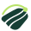
</p>

<h1 align="center">ПолеЗрение</h1>

<p align="center">
  Спутниковый мониторинг полей, восстановление NDVI, объяснимые сигналы риска<br>
  и AI-помощник агронома в одном рабочем контуре.
</p>

<p align="center">
  <a href="http://193.233.221.4/"><strong>Открыть демо →</strong></a>
</p>

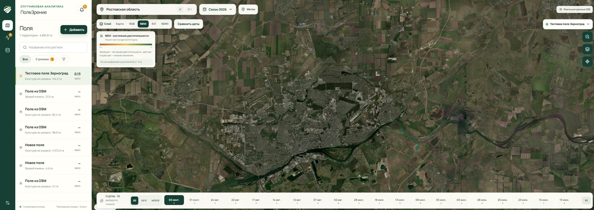

## 🥈 КосмоХакатон 2026 · Ростов-на-Дону

Команда **R² negative** заняла **2-е место** на КосмоХакатоне Южного и Северо-Кавказского федеральных округов и получила командный приз **200 000 ₽**. «ПолеЗрение» помогает агроному отслеживать состояние полей по спутниковым данным.

[▶ Смотреть демонстрацию проекта](docs/hackathon/demo.mp4) · [Презентация PDF](docs/hackathon/presentation.pdf)

| Команда | Результат | Приз | Проект |
|---|---|---|---|
| **R² negative** | **2-е место** | **200 000 ₽** | Спутниковый мониторинг полей и AI-помощник агронома |

## О решении

Агроном получает много разрозненных данных: снимки разных спутников, облачные даты, погодные показатели и длинные временные ряды. По ним трудно быстро понять, где действительно начинается устойчивое ухудшение, почему система подняла сигнал и куда ехать на осмотр.

«ПолеЗрение» собирает этот процесс в понятный сценарий:

1. пользователь находит готовый контур поля в OpenStreetMap или рисует свой;
2. платформа автоматически получает спутниковые и метеорологические данные;
3. пропуски NDVI восстанавливаются с учётом источника, сезона и истории поля;
4. текущая динамика сравнивается с фазово выровненной исторической нормой;
5. устойчивое отклонение превращается в объяснимый сигнал и точки осмотра;
6. результат проверки возвращается в систему, а AI-помощник отвечает на вопросы и формирует PDF-отчёт по выбранному полю.

Система не выдаёт единичную низкую точку за проблему и не называет гипотезу агрономическим диагнозом. В интерфейсе отдельно показаны фактические и восстановленные значения, источник снимка, облачность, неопределённость и основания сигнала.

## Что доступно пользователю

| Возможность | Практическая польза |
| --- | --- |
| Поиск региона, выбор OSM-контура и ручное рисование | Поле можно завести без подготовки GIS-файлов, но GeoJSON также поддерживается |
| Слои RGB, NDVI, EVI и NDWI | Быстрая визуальная проверка растительности и влаги по фактической сцене |
| Лента сцен Sentinel-2, Landsat 8/9 и MODIS | Понятно, какие даты и источники действительно доступны |
| Сравнение дат «до/после» | Локальные изменения видны непосредственно на карте |
| График фактов, восстановленных точек и исторической нормы | Видна динамика сезона, происхождение значения и доверие к нему |
| Центр внимания | Поля ранжируются по срочности, а не теряются в списке |
| Карточка доказательств | Сигнал содержит наблюдение, контекст, гипотезу, доверие и следующий шаг |
| Кликабельные точки осмотра | Агроном получает конкретные места, меняет их статус, редактирует и удаляет |
| Метки и заметки на отдельной панели | Личные наблюдения не смешиваются с системными заданиями осмотра |
| AI-чат и PDF-отчёт | Ответ строится по данным выбранного поля и может включать график, схему контура, источники и ограничения |
| Экспорт CSV | Подготовленный набор можно проверить или использовать во внешней аналитике |

## Рабочий сценарий агронома

### 1. Понять состояние поля

После сохранения контура сбор запускается автоматически. На карте появляются реальные сцены, показатели выбранной даты и краткий вывод. Если один из источников временно недоступен, анализ продолжится по оставшимся пригодным спутниковым данным; пропуск источника фиксируется в паспорте набора.

### 2. Проверить сигнал на местности

Система оценивает реальные пиксели Sentinel-2 ниже исторического Q10, считает затронутую площадь и предлагает до трёх точек осмотра. Каждая точка открывается по клику, содержит понятную причину выбора и поддерживает изменение статуса, редактирование и удаление.

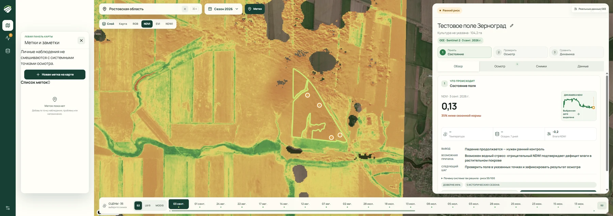

### 3. Разобрать динамику

Интерактивный график объединяет фактические наблюдения, восстановленные пропуски, сглаженный ряд и коридор прошлых сезонов. Для каждой даты доступны источник, облачность, число валидных пикселей, погода и неопределённость восстановления. Отдельный режим накладывает выбранный прошлый сезон.

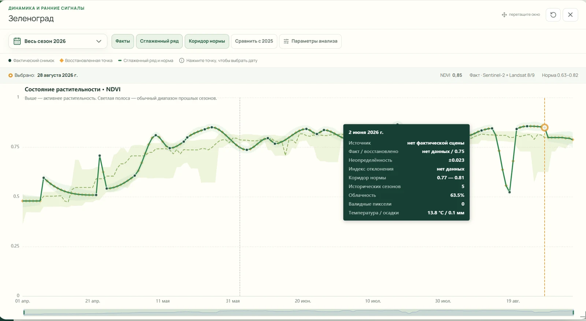

### 4. Организовать работу с рисками

Центр внимания отделяет ранний контроль от подтверждённых аномалий и закрытых задач. Жизненный цикл сигнала хранится явно: `обнаружен → назначен → проверен → подтверждён/отклонён → закрыт`.

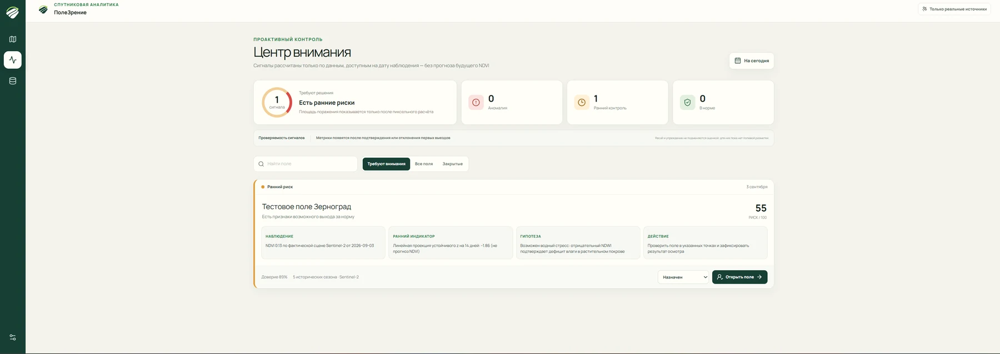

### 5. Задать вопрос или подготовить отчёт

AI-помощник получает структурированный контекст только выбранного поля. Он может объяснить динамику, перечислить ограничения данных, предложить план осмотра и собрать PDF с текстом, графиком NDVI, схемой территории и паспортом источников. Факты и гипотезы в ответе разделяются.

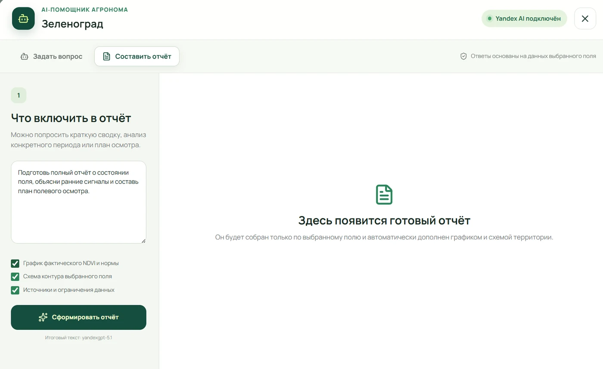

## Данные и аналитический контур

| Источник | Нативное разрешение | Использование |
| --- | ---: | --- |
| Sentinel-2 L2A | 10 м | NDVI, EVI, NDWI, RGB, тайлы и пространственный риск |
| Landsat 8/9 L2 | 30 м | резерв и расширение временного ряда |
| MODIS MOD13Q1 | 250 м | устойчивый резерв временного ряда |
| ERA5-Land | около 11 км | температура, осадки и контекст интерпретации |
| ESA WorldCover 2021 | 10 м | проверка, что контур относится к пахотным землям |
| OpenStreetMap | векторные контуры | поиск сельскохозяйственных территорий |

Значения агрегируются внутри полигона в нативном масштабе источника. Landsat, MODIS и ERA5 не маскируются под искусственные измерения 10 м.

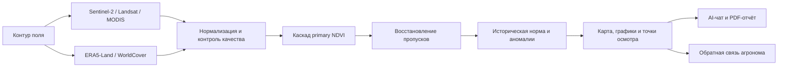

### Восстановление NDVI

Конкурсная модель **v8** используется для точных ключей replacement test и воспроизводит результат **RMSE 0.0712** на 2 323 скрытых точках 20 полей. В ней объединены:

- общая модель CatBoost + LightGBM;
- три LightGBM-эксперта для Sentinel-2, Landsat и MODIS;
- классификатор вероятного источника скрытого измерения;
- локальная геометрия пропуска, сезон, история поля и синхронный контекст других полей;
- фиксированный ансамбль `0.20 × общая модель + 0.80 × эксперты сенсоров`.

Для произвольного нового поля готовые конкурсные ответы не подставляются. Продуктовый контур применяет универсальное мультисенсорное сезонное восстановление PCHIP, аккуратное заполнение краёв и оценку неопределённости. `primary_ndvi_pred` означает восстановление пропусков внутри доступного сезона, а не прогноз будущего NDVI.

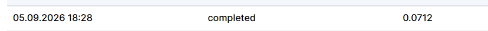

### Детекция аномалий

Детектор сравнивает непрерывную кривую с робастной нормой поля и выравнивает сезонную фазу в пределах ±21 дня. Основной сигнал требует устойчивого дефицита NDVI, достаточной длительности, минимум двух реальных наблюдений и двух подтверждений из EVI, NDWI, осадков и температуры. Контрольный артефакт воспроизводит 11 интерпретируемых событий на 10 полях.

Причина события остаётся проверяемой гипотезой. Реальные precision/recall появляются только после накопления независимой полевой разметки.

### AI-помощник

| Задача | Модель Yandex AI Studio |
| --- | --- |
| Диалог и выбор нужного контекста | `aliceai-llm-flash` |
| Итоговый агрономический отчёт | `yandexgpt-5.1` |
| Анализ изображения | `qwen3.6-35b-a3b` |

API-ключ остаётся на сервере и не попадает в браузер. Логирование пользовательских данных у провайдера отключается настройкой `YANDEX_AI_DISABLE_LOGGING=true`.

## Архитектура

```text
Браузер
  └─ web: React 19 + TypeScript + MapLibre + ECharts
       └─ api: FastAPI
            ├─ PostgreSQL/PostGIS  — поля, ряды, сигналы и статусы
            ├─ Redis              — кэш тайлов и очереди
            ├─ Celery worker      — сбор, восстановление и анализ
            ├─ Celery beat        — периодические задания
            ├─ Google Earth Engine / OSM / Yandex AI Studio
            └─ артефакты v8 и детектора аномалий
```

Продакшен-конфигурация публикует только Nginx; API, PostgreSQL и Redis остаются во внутренней Docker-сети.

## Быстрый запуск через Docker

### Требования

- Git;
- Docker Engine / Docker Desktop с Compose v2;
- рекомендуется от 4 CPU, 8 ГБ RAM и 20 ГБ свободного места;
- для реальных спутниковых данных — проект Google Earth Engine и JSON-ключ сервисного аккаунта;
- для AI-функций — API-ключ и Folder ID Yandex AI Studio.

### 1. Получить репозиторий

```bash
git clone https://github.com/Yujir0k/PoleZrenie-Kosmo-Rostov.git
cd kosmo-rostov_r2_negative_87/platform
```

### 2. Подготовить окружение

Linux/macOS:

```bash
cp .env.example .env
mkdir -p secrets data output
```

Windows PowerShell:

```powershell
Copy-Item .env.example .env
New-Item -ItemType Directory -Force secrets, data, output
```

Заполните в `platform/.env`:

```dotenv
GEE_PROJECT=your-google-cloud-project
GEE_SERVICE_ACCOUNT_FILE=/run/secrets/gee-service-account.json

YANDEX_API_KEY=your-yandex-api-key
YANDEX_FOLDER_ID=your-yandex-folder-id
```

JSON-ключ Earth Engine положите в `platform/secrets/gee-service-account.json`. Файлы `.env` и `secrets/*` исключены из Git.

Без Yandex-ключа платформа запускается, но AI-раздел будет отключён. Без Earth Engine останутся интерфейс и OSM-поиск, но реальный спутниковый анализ запустить нельзя.

### 3. Запустить все сервисы

```bash
docker compose up -d --build
```

После первого запуска доступны:

- интерфейс — <http://localhost:3001>;
- API — <http://localhost:8000>;
- OpenAPI — <http://localhost:8000/docs>.

Проверка состояния:

```bash
docker compose ps
curl http://localhost:8000/health
curl http://localhost:8000/api/v1/system/providers
curl http://localhost:8000/api/v1/ai/status
```

Остановка без удаления данных:

```bash
docker compose down
```

### Продакшен-запуск

Укажите в `.env` случайный пароль БД и публичный origin, затем используйте отдельный Compose-файл:

```dotenv
ENVIRONMENT=production
PUBLIC_ORIGIN=https://your-domain.example
POSTGRES_DB=vegetation
POSTGRES_USER=vegetation
POSTGRES_PASSWORD=replace-with-a-long-random-password
```

```bash
docker compose -f docker-compose.prod.yml up -d --build
```

`docker-compose.prod.yml` запускает Nginx на порту 80. TLS рекомендуется завершать на внешнем reverse proxy или настроить сертификат для домена.

## Сбор данных, обучение и инференс

### Сбор для произвольного поля

Сохраните `Polygon` или `Feature` в `platform/data/field.geojson` и выполните:

```bash
docker compose run --rm api python -m app.cli.collect \
  --geometry /data/field.geojson \
  --polygon-id my-field \
  --crop-type "Озимая пшеница" \
  --start-year 2021 \
  --output /output/my-field.csv
```

Результат появится в `platform/output/my-field.csv`, рядом будет `my-field.profile.json` со статусом и разрешением каждого источника.

### Batch-инференс v8 и submission

Готовый `platform/data/New_test.csv` можно обработать серверным адаптером:

```bash
docker compose run --rm api python -m app.cli.infer \
  --input /data/New_test.csv \
  --output /output/submission.csv
```

Итоговый файл: `platform/output/submission.csv`. Контракт replacement test: `anon_polygon_id,date,primary_ndvi_true`; экспорт прерывается при NaN, дубликатах или несовпадении ключей.

Полное воспроизведение v8 с построением признаков и обучением ансамбля:

```bash
cd model_review/forecast/NDVI_v8_product_handoff_0712
python -m venv .venv
# Linux/macOS: source .venv/bin/activate
# Windows:     .venv\Scripts\Activate.ps1
python -m pip install -r requirements.txt
python run_v8.py
python validate_submission.py \
  --test data/New_test.csv \
  --submission output/submission.csv
```

`run_v8.py` обучает ансамбль при batch-запуске; кэш признаков сохраняется в `work/`. Готовый проверенный submission также лежит в `model_review/forecast/NDVI_v8_product_handoff_0712/submission.csv`.

### Автономная проверка детектора аномалий

```bash
cd model_review/anomaly/ndvi_anomaly_detector
python -m pip install -r requirements.txt
python infer_anomalies.py \
  --model model/anomaly_detector.joblib \
  --input path/to/current.csv \
  --output-dir output
```

Команда создаёт `anomaly_events.csv`, ежедневную кривую, список пропущенных полей, флаги качества и краткий `summary.json`.

## Структура данных

Основная строка — наблюдение одного поля за одну дату.

- идентификаторы: `anon_polygon_id`, `date`, `year`, `doy`, `crop_type`;
- Sentinel-2: `s2_ndvi`, `s2_evi`, `s2_ndwi`, валидные пиксели и облачность;
- Landsat: `landsat_ndvi`, `landsat_evi`, `landsat_ndwi` и качество сцены;
- MODIS: `modis_ndvi`, `modis_evi`;
- погода: `era5_temp_c`, `era5_precip_mm`;
- модель: `primary_ndvi`, `primary_ndvi_pred`, `prediction_uncertainty`, `is_synthetic_gap`;
- норма и сигналы: климатология, z-score, статус и подтверждающие признаки.

`primary_ndvi` строится прозрачным каскадом `Sentinel-2 → Landsat → MODIS`. Отсутствующие измерения остаются `NaN`, а не превращаются в нули. Профиль сбора хранит доступные и отсутствующие источники и признак деградированного режима.

## Основные API-маршруты

| Метод и путь | Назначение |
| --- | --- |
| `GET /api/v1/regions/search` | поиск региона через Nominatim |
| `GET /api/v1/field-candidates` | реальные сельскохозяйственные контуры Overpass |
| `POST /api/v1/fields` | создание поля и автоматический запуск анализа |
| `POST /api/v1/analysis-jobs` | фоновый сбор и анализ, прогресс доступен через SSE |
| `GET /api/v1/fields/{id}/timeseries` | фактический и восстановленный временной ряд |
| `GET /api/v1/fields/{id}/spatial-risk` | площадь риска и кандидаты точек осмотра |
| `GET /api/v1/attention` | центр ранних и подтверждённых сигналов |
| `GET /api/v1/system/providers` | фактическая доступность источников |
| `POST /api/v1/ai/chat` | вопрос по выбранному полю |
| `POST /api/v1/ai/report` | формирование агрономического отчёта |

## Структура репозитория

```text
platform/
  api/                 FastAPI, Celery, провайдеры данных и интеграция моделей
  web/                 React/TypeScript-интерфейс, карта и визуализации
  data/                входные файлы для контейнерных CLI
  output/              CSV, паспорта данных и сформированные материалы
  secrets/             локальные ключи, не отслеживаются Git
  docker-compose.yml   локальный запуск
  docker-compose.prod.yml

model_review/
  forecast/NDVI_v8_product_handoff_0712/
                        модель v8, данные, обучение, валидация и submission
  anomaly/ndvi_anomaly_detector/
                        детектор, готовый joblib и контрольный пример

docs/images/            иллюстрации README
```

## Проверки

```bash
cd platform
docker compose run --rm --build api pytest -q
docker compose build web
```

Локальные проверки фронтенда:

```bash
cd platform/web
npm ci
npm run lint
npx tsc --noEmit
npm run build
```

Тесты API покрывают геометрию, каскад источников, безопасную деградацию, модельный контракт, JSON без ложных нулей и точное применение v8 для ключей replacement test.

## Ограничения

- без как минимум трёх прошлых сезонов индивидуальная историческая норма нового поля недостаточно надёжна;
- ERA5-Land пространственно грубее поля, а EVI и NDWI частично зависят от тех же условий съёмки, что NDVI;
- гипотеза причины сигнала требует полевой проверки;
- реальные метрики качества сигналов появятся после накопления подтверждений агрономов;
- конкурсная v8 предназначена для воспроизводимого replacement test, а не для произвольных новых геометрий.


## Презентация

[Открыть презентацию в PDF](docs/hackathon/presentation.pdf)

<details>
<summary>Листать презентацию прямо в README</summary>

<p align="center">
  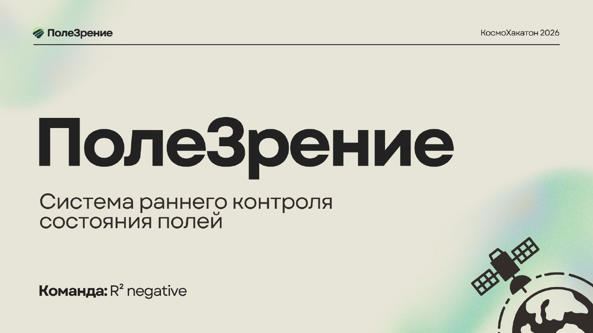
  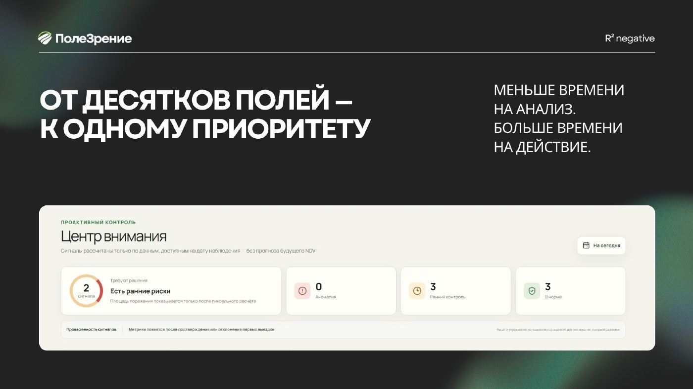
  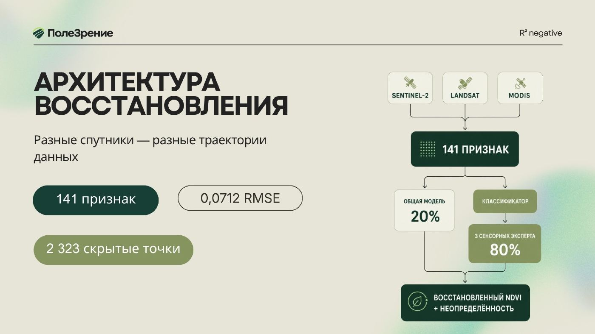
  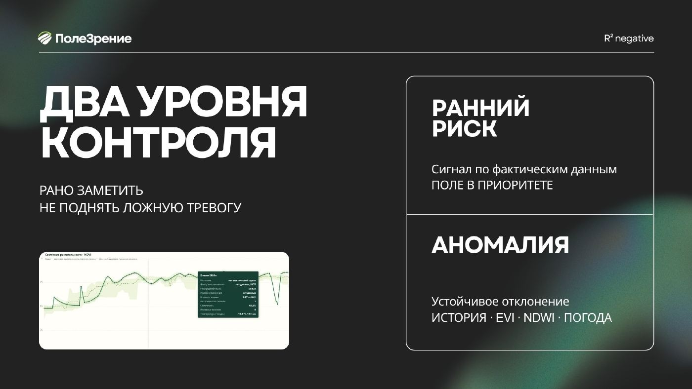
  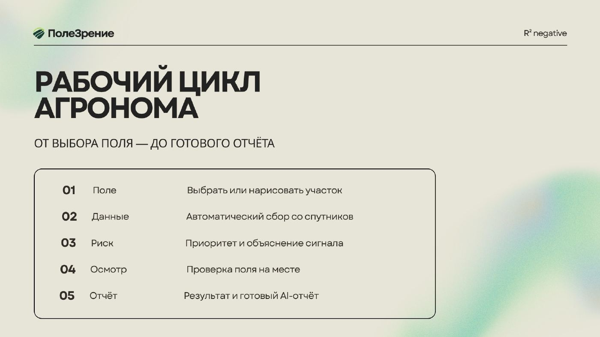
  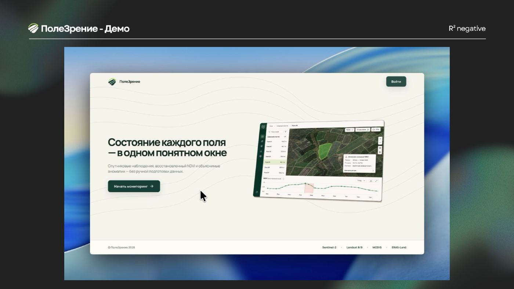
  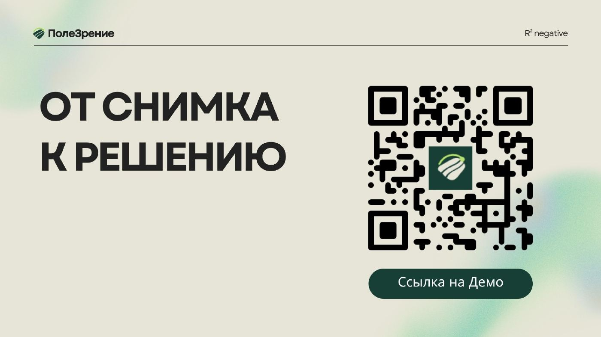
</p>

</details>

## Диплом

<p align="center">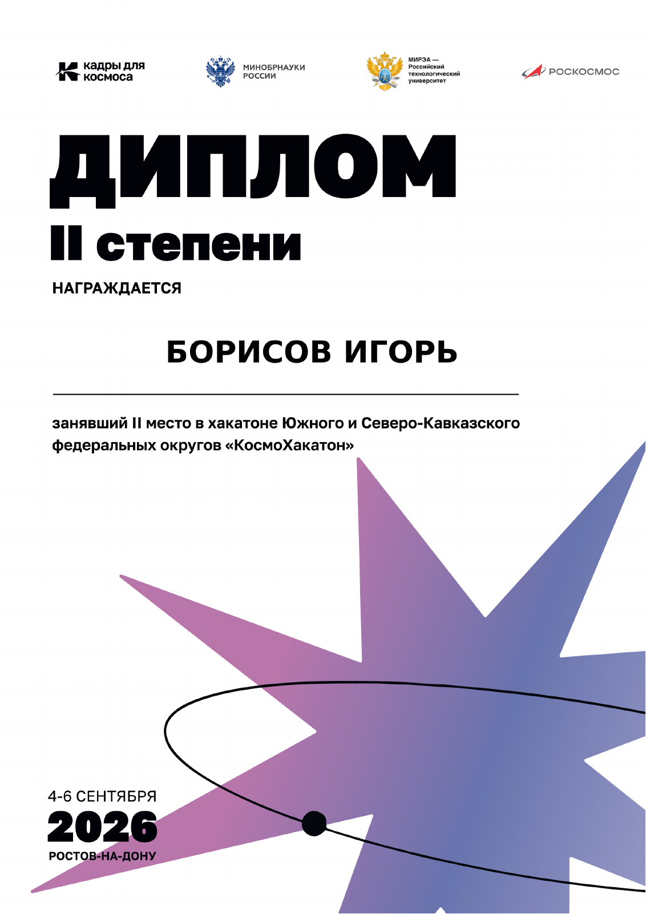</p>
