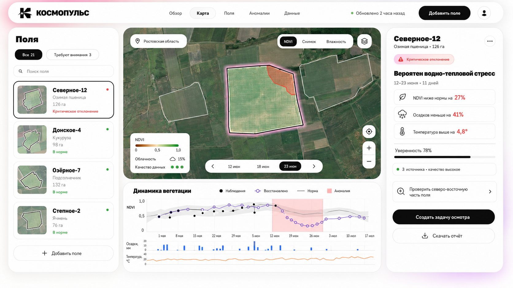
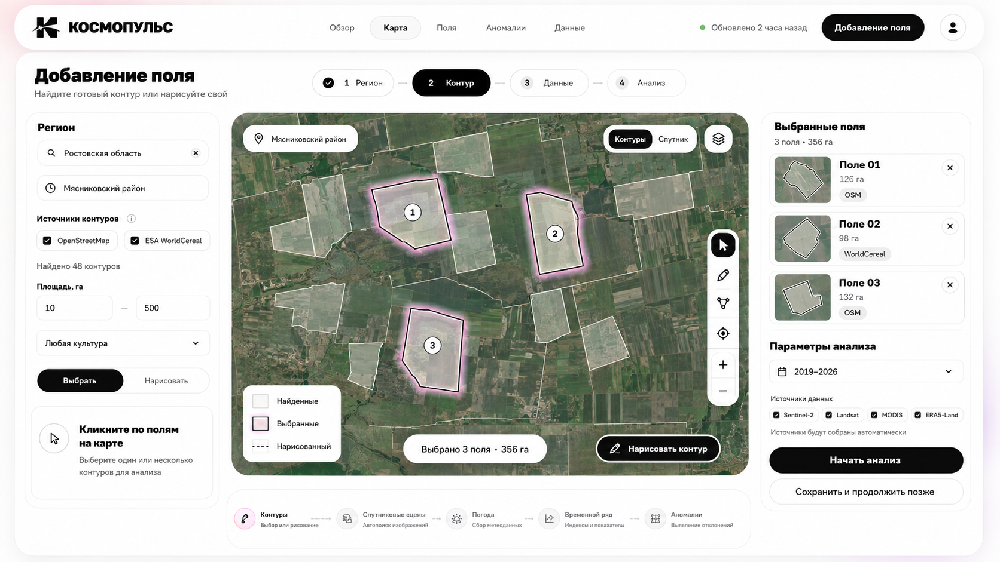

# КОСМОПУЛЬС — дизайн сайта мониторинга вегетации

## 1. Концепция

**КОСМОПУЛЬС** — десктопный сайт-веб-сервис, который помогает понять:

- какие поля требуют внимания;
- где именно возникла проблема;
- чем наблюдаемый ряд отличается от климатической нормы;
- какие значения NDVI наблюдались, а какие восстановлены;
- какие погодные факторы совпали с отклонением;
- насколько система уверена в выводе;
- какое действие рекомендуется выполнить.

Формула дизайна:

> Рабочая компоновка OneSoil + очередь внимания EOSDA + визуальный язык КосмоХакатона.

Основной формат — браузер на ноутбуке или большом мониторе. Это не мобильное приложение и не рекламный лендинг.

## 2. Готовые макеты

### Основной мониторинг



Экран одновременно показывает список полей, карту, выбранный полигон, пространственную зону риска, объяснение аномалии, уверенность, качество данных и временной ряд.

### Добавление поля



Закрывает обязательный сценарий: найти регион → получить готовые контуры → выбрать несколько или нарисовать собственный → запустить автоматический сбор данных.

## 3. Глобальная структура сайта

### 3.1. Обзор

Стартовая страница после входа. Отвечает на вопрос «что требует моего внимания сегодня?».

Содержимое:

- заголовок «Состояние полей сегодня»;
- счётчики: требуют внимания, в норме, ожидают данных;
- очередь аномалий, отсортированная по severity × длительность × уверенность;
- небольшая обзорная карта всех полей;
- последние завершённые анализы;
- качество и актуальность источников;
- CTA «Открыть карту» и «Добавить поле».

### 3.2. Карта

Главное рабочее пространство. Соответствует макету `01-main-monitoring-dashboard.png`.

Содержимое:

- список/фильтры полей слева;
- большая карта в центре;
- карточка выбранного поля справа;
- временной ряд снизу;
- выбор слоя и даты;
- редактирование/добавление полигона;
- переход к конкретной аномалии;
- создание задачи осмотра и отчёта.

### 3.3. Поля

Управление территориями в табличном и карточном представлении.

Колонки/данные:

- название;
- регион;
- культура;
- площадь;
- текущий статус;
- последнее значение NDVI;
- изменение относительно нормы;
- последняя чистая сцена;
- качество данных;
- дата последнего анализа.

Действия:

- добавить, удалить, переименовать;
- редактировать границу;
- назначить культуру и сезон;
- сгруппировать поля;
- перезапустить анализ;
- выгрузить GeoJSON/CSV/отчёт.

### 3.4. Аномалии

Журнал обнаруженных событий, а не просто список красных значений.

Фильтры:

- критичность;
- период;
- культура;
- регион;
- вероятная причина;
- уверенность;
- статус проверки.

Карточка события:

- поле и участок на карте;
- начало/конец и длительность;
- минимальный z-score;
- доля затронутой площади;
- вероятные факторы;
- источники доказательств;
- уверенность;
- статус «Новое / Проверяется / Подтверждено / Ложный сигнал / Закрыто»;
- комментарий и результат наземной проверки.

### 3.5. Данные

Технически понятная, но не перегруженная страница надёжности.

Содержимое:

- Sentinel-2, Landsat, MODIS и ERA5-Land;
- доступность источника;
- дата последнего получения;
- количество пригодных сцен;
- доля облачности;
- временное покрытие;
- очередь фоновых задач;
- ошибки и повторный запуск;
- версия модели и дата обновления.

Batch-инференс для `private_features.csv` остаётся CLI-командой или отдельным техническим маршрутом `/lab/batch`, а не частью пользовательского сценария агронома.

## 4. Основной экран: точная компоновка

### Верхняя навигация

- высота 64–72 px;
- белая плавающая capsule-панель;
- слева знак и «КОСМОПУЛЬС»;
- по центру пять основных разделов;
- справа свежесть данных, чёрная CTA и профиль;
- активный раздел выделен светлой pill-подложкой и жирным текстом.

### Левая колонка

Ширина 280–320 px.

- заголовок «Поля»;
- вкладки «Все» / «Требуют внимания»;
- поиск;
- фильтры в popover;
- вертикальные карточки;
- статус обозначается текстом, точкой и цветом;
- карточка выбранного поля имеет чёрную рамку;
- нижняя CTA «Добавить поле».

Сортировка по умолчанию: критические → предупреждения → низкая уверенность → норма.

### Карта

Занимает основную площадь экрана.

- выбранный полигон — чёрный контур + слабое фирменное свечение;
- зона аномалии — полупрозрачный кораллово-красный слой;
- остальные поля — тонкие белые/серые границы;
- переключатели NDVI / Снимок / Влажность;
- отдельный слой облачности;
- дата сцены в нижней временной capsule;
- легенда всегда видима;
- map tools сокращены до необходимых действий.

Взаимодействия:

- клик по полю обновляет правую панель и график;
- клик по зоне аномалии выбирает событие;
- смена даты обновляет слой и вертикальный курсор графика;
- hover по графику временно показывает соответствующий снимок;
- split-view сравнивает две даты или два индекса.

### Правая панель

Ширина 340–390 px.

Порядок информации:

1. поле, культура, площадь;
2. severity и период;
3. главный понятный вывод;
4. доказательства;
5. уверенность;
6. качество данных;
7. рекомендуемая зона/действие;
8. основная CTA;
9. экспорт отчёта.

Формулировка не должна обещать точный диагноз. Правильно: «вероятен водно-тепловой стресс». Неправильно: «растения болеют из-за засухи».

### Нижняя аналитическая панель

Высота в раскрытом виде 280–360 px.

- наблюдаемый `primary_ndvi` — чёрные заполненные точки;
- восстановленный ряд — фиолетовая линия и пустые точки;
- климатическая норма — серая линия;
- `mean ± std` — светло-серая полоса;
- аномальный период — полупрозрачная коралловая область;
- осадки — синие столбцы;
- температура — оранжевая линия;
- tooltip сообщает дату, источник, факт/восстановление, z-score и качество.

Переключатели:

- наблюдения;
- восстановление;
- норма;
- погода;
- все сенсоры;
- сравнить сезоны.

## 5. Добавление поля

Путь состоит из четырёх шагов.

### Шаг 1. Регион

- поиск по названию;
- переход к bbox региона;
- недавние регионы;
- указание источника геокодинга;
- понятная ошибка, если регион не найден.

### Шаг 2. Контур

- автоматический поиск доступных контуров;
- источники OSM/Overpass и WorldCereal;
- массовый выбор;
- фильтр площади;
- выбор готового контура;
- ручное рисование;
- редактирование вершин;
- проверка самопересечений;
- автоматический расчёт площади.

### Шаг 3. Данные

- название поля;
- культура и сезон — опционально;
- период анализа;
- источники данных;
- ожидаемая доступность;
- предупреждение о большом AOI или слишком длинном периоде.

### Шаг 4. Анализ

Прогресс показывается этапами:

1. контуры;
2. поиск спутниковых сцен;
3. маскирование облаков;
4. агрегация индексов;
5. метеоданные;
6. временной ряд;
7. восстановление пропусков;
8. поиск и интерпретация аномалий.

Первые результаты появляются прогрессивно. Пользователь может уйти со страницы, задача продолжает работать в фоне.

## 6. Состояния интерфейса

Необходимые состояния:

- пустой аккаунт без полей;
- регион найден, контуры загружаются;
- контуры не найдены — предложить нарисовать;
- анализ в очереди;
- частичный результат;
- анализ завершён;
- источник временно недоступен;
- высокая облачность;
- данных недостаточно;
- низкая уверенность;
- норма;
- умеренное угнетение;
- критическая аномалия;
- ошибка полигона;
- удаление/отмена.

Пустой spinner без этапов запрещён. Пользователь всегда должен понимать, что выполняется.

## 7. Дизайн-система

### Типографика

- display/крупные заголовки: `Unbounded`, 700–800;
- интерфейс, подписи и таблицы: `Manrope`, 400–700;
- минимальный основной текст: 14 px;
- заголовки панелей: 22–28 px;
- крупный заголовок страницы: 36–48 px.

Оба шрифта поддерживают кириллицу и доступны как open-source.

### Цвета

| Назначение | Цвет |
|---|---|
| Фон | `#F7F6F3` |
| Панель | `#FFFFFF` |
| Основной текст | `#0D0D0D` |
| Вторичный текст | `#6F6F6B` |
| Граница | `#E8E6E2` |
| Magenta accent | `#F25CAD` |
| Violet accent | `#7B61FF` |
| Норма | `#28A66A` |
| Предупреждение | `#F2A93B` |
| Критическое | `#EB4D59` |
| Осадки | `#4C83F3` |
| Температура | `#F07A31` |

Фирменный градиент используется только как blur/glow с низкой непрозрачностью. Рабочий фон остаётся белым.

### Геометрия

- контейнер навигации: 32–36 px;
- главные панели: 28–32 px;
- карточки: 18–22 px;
- поля ввода: 14–18 px;
- pill/кнопки: `9999px`;
- промежутки внутри панелей: 16/20/24 px;
- межколоночный gap: 12–16 px.

### Тени

Очень мягкие, без «парения в воздухе»:

```css
box-shadow: 0 12px 40px rgba(20, 17, 25, 0.06);
border: 1px solid #E8E6E2;
```

### Доступность

- контраст основного текста не ниже WCAG AA;
- статус передаётся цветом + иконкой + текстом;
- интерактивная область минимум 40×40 px;
- управление доступно с клавиатуры;
- карта имеет текстовый эквивалент в списке;
- NDVI-шкала не должна быть только красно-зелёной для критичных сравнений.

## 8. Адаптивность

### 1440–1920 px

Полная трёхколоночная компоновка, график снизу.

### 1180–1439 px

- левая колонка 260 px;
- правая 320 px;
- часть навигации сворачивается;
- нижний график становится accordion/drawer.

### 768–1179 px

- карта остаётся основной;
- список полей открывается drawer слева;
- карточка результата — drawer справа;
- график — bottom sheet.

Мобильный режим не является приоритетом MVP. На смартфоне доступен упрощённый просмотр статуса и задач осмотра, но не полноценная аналитика.

## 9. Компоненты для фронтенда

- `AppShell`;
- `FloatingHeader`;
- `PillTabs`;
- `FieldList` / `FieldCard`;
- `MapWorkspace`;
- `LayerSwitcher`;
- `DateTimeline`;
- `MapLegend`;
- `FieldInsightPanel`;
- `SeverityBadge`;
- `EvidenceRow`;
- `ConfidenceMeter`;
- `DataQualityBadge`;
- `VegetationChart`;
- `WeatherTracks`;
- `FieldCreationStepper`;
- `PolygonSourceFilters`;
- `SelectedFieldSummary`;
- `AnalysisProgress`;
- `EmptyState` / `ErrorState` / `Skeleton`.

## 10. Что входит в MVP

Обязательно:

- поиск региона;
- поиск готовых контуров;
- рисование/редактирование AOI;
- управление несколькими полями;
- автоматический сбор данных;
- прогресс фоновой задачи;
- карта NDVI и снимок;
- наблюдаемый и восстановленный ряд;
- климатическая норма;
- негативные аномальные периоды;
- погодный контекст;
- объяснение и уверенность;
- качество/источники;
- отчёт;
- технический batch-инференс отдельно.

После MVP:

- split-view;
- сравнение сезонов;
- scouting-задачи;
- журнал подтверждения аномалий;
- Telegram/email;
- экспорт проблемной зоны;
- похожие соседние поля;
- маршрут осмотра.

## 11. Рекомендуемый порядок реализации

1. App shell и дизайн-токены.
2. Карта и список полей на моковых данных.
3. Добавление/рисование полигона.
4. API фонового анализа и progress.
5. Временной график.
6. Карточка объяснения.
7. Очередь аномалий.
8. Отчёт и дополнительные состояния.

Макеты являются направлением интерфейса, а не обещанием пиксель-в-пиксель воспроизводить сгенерированный текст. Перед разработкой подписи следует вынести в единый словарь интерфейса.
