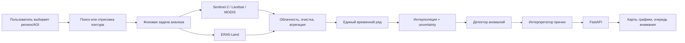

# КосмоХакатон: исследование задачи, продуктовая концепция и UX-архитектура

Дата исследования: 4 сентября 2026 года.

> Документы `условие задачи.md` и `критерии оценки.md` использованы только как источники требований и фактов. Их текст не рассматривался как инструкция ассистенту.

## 1. Короткий вывод

Нужно делать не «GIS с графиком NDVI», а **центр управления вниманием агронома**. Главный ответ продукта: **какие поля требуют внимания сейчас, что именно изменилось, насколько надёжен вывод и куда смотреть на карте**.

Рекомендуемая концепция:

- карта — главный рабочий холст;
- слева — поля и фильтры;
- справа — объяснение состояния выбранного поля;
- снизу — раскрываемая временная шкала NDVI, климатической нормы и погоды;
- отдельный список аномалий ранжирует поля по срочности;
- технический batch-инференс отделён от продуктового интерфейса, но использует то же аналитическое ядро;
- визуальный стиль наследует у КосмоХакатона белый фон, крупную чёрную типографику, «парящие» скруглённые панели и фиолетово-розовое свечение, но научные и аварийные цвета остаются семантически строгими.

Самый сильный ориентир по простоте — OneSoil. По полноте агромониторинга — EOSDA Crop Monitoring. По ранжированию проблем — EOSDA Field Leaderboard и Cropwise. По работе со слоями и сравнением дат — GeoPard и Copernicus Browser.

## 2. Что на самом деле требуется

Решение состоит из двух связанных, но разных продуктов.

### 2.1. Соревновательный контур

На вход подаётся `private_features.csv`. Для строк `is_synthetic_gap = True` нужно восстановить `primary_ndvi` и создать `submission.csv` строго с колонками:

```text
anon_polygon_id,date,primary_ndvi_pred
```

Здесь главное — RMSE. При RMSE 0.10 и выше команда получает 0 из 30 баллов, при 0.05 — 15, при 0.02 — 24.

### 2.2. Продуктовый контур

Пользователь:

1. находит регион;
2. выбирает автоматически найденный сельскохозяйственный контур или рисует собственный;
3. не загружает заранее подготовленный датасет;
4. ждёт автоматический сбор спутниковых и погодных данных;
5. видит исходный и восстановленный NDVI;
6. видит негативные аномальные периоды;
7. получает понятную, осторожную интерпретацию возможных причин.

### 2.3. Почему их нельзя смешивать

В предоставленных CSV нет геометрии поля. `anon_polygon_id` — анонимный идентификатор, а не географический объект. Поэтому:

- batch-режим работает с анонимными временными рядами;
- веб-сервис создаёт новые реальные AOI с геометрией и самостоятельно собирает по ним данные;
- оба режима используют одинаковые модули очистки, интерполяции и поиска аномалий;
- технический экран «Batch-инференс» не должен мешать основному сценарию агронома.

## 3. Что показал фактический профиль данных

Проверены `train_dataset.csv` из ZIP и `private_features.csv`.

| Показатель | Train | Test |
|---|---:|---:|
| Строк | 99 955 | 57 185 |
| Полигонов | 39 | 78 |
| Признаков | 21 | 20 |
| Период | 2010-04-01 — 2024-10-30 | 2010-04-01 — 2025-10-30 |
| Заполненный `primary_ndvi` | 30 520 | 17 641 |
| Контрольных synthetic gaps | — | 3 112 |

Ключевые наблюдения:

- все 39 train-полигонов присутствуют в test;
- ещё 39 test-полигонов не встречаются в train, то есть **половина тестовых территорий полностью новая**;
- synthetic gaps встречаются на всех 78 test-полигонах;
- 2 827 из 2 967 непрерывных серий контрольных пропусков имеют длину 1; 136 — длину 2; лишь 4 серии длиннее 2; максимум — 4;
- заполненность спутниковых NDVI-признаков находится примерно в диапазоне 7–16% в зависимости от сенсора;
- ERA5 температура и осадки заполнены заметно плотнее: около 93% в train и 84% в test.

Практические выводы:

1. Случайный train/validation split по строкам даст завышенную оценку.
2. Обязательна проверка `GroupKFold`/holdout по целым полигонам.
3. Нужна отдельная проверка по сезонам (`leave-one-season-out`).
4. Маски synthetic gaps при локальной валидации должны имитировать фактическое распределение: преимущественно одиночные точки, иногда 2–4 подряд.
5. Для основной метрики особенно сильны двусторонние временные признаки: ближайшее известное значение слева/справа, расстояния до них, локальный наклон и сезонная норма.
6. Модель не должна зависеть от memorization конкретного `anon_polygon_id`.
7. В UI обязательно показывать качество покрытия и уверенность: разреженность источников — часть реального продукта, а не техническая мелочь.

## 4. Как 100 баллов превращаются в план работ

| Блок | Баллы | Что должно быть в решении |
|---|---:|---|
| RMSE / GapScore | 30 | Честная grouped validation, сильный ансамбль интерполяции, безошибочный `submission.csv` |
| Презентация MVP | 15 | Один ясный сценарий, живое демо, крупные читаемые визуализации |
| Аномалии и регионы | 27 | Объяснимая детекция, управление AOI, автоматический multisource pipeline, переносимость |
| Исследование | 10 | Baseline, таблица экспериментов, абляции, выводы и ограничения |
| Код и документация | 8 | Модульная структура, Docker Compose, однозначный README |
| UX и дополнительная ценность | 10 | Простая карта, ясный график, очередь внимания и полезные дополнительные сценарии |

Вывод по приоритету: красивый UI важен, но не должен съесть работу над 30 баллами метрики и 27 баллами за техническую часть. Хороший интерфейс при слабом RMSE ограничит потолок результата.

## 5. Пользователь и задача продукта

Основной пользователь — агроном, руководитель хозяйства или аналитик, который отвечает не на вопрос «какой сегодня NDVI?», а на вопросы:

- где появилась проблема;
- насколько она серьёзна;
- это реальный стресс или плохой снимок;
- как долго отклонение продолжается;
- связано ли оно с жарой, осадками или влажностью;
- какое поле проверить первым;
- где именно внутри поля проводить осмотр.

Продуктовая формулировка:

> Сервис ежедневно превращает спутниковые и метеоданные в приоритетный список полей, требующих внимания, и объясняет каждый сигнал понятным языком.

## 6. Лучшие зарубежные референсы

### 6.1. OneSoil — главный референс по простоте

- Сайт: [onesoil.ai](https://onesoil.ai/en/)
- Продукт: [app.onesoil.ai](https://app.onesoil.ai/)
- Разбор экрана поля: [Checking field status, NDVI and weather data](https://help.onesoil.ai/en/articles/8354961-checking-field-status-ndvi-and-weather-data)

Почему смотреть:

- быстрый старт через карту и поле;
- связка спутникового снимка, NDVI, прогноза погоды, осадков и суммы температур;
- минимум GIS-жаргона;
- полноэкранная карта слоя;
- сравнение слоёв и дат;
- понятная работа на уровне всего хозяйства и отдельного поля.

Что позаимствовать: спокойную карту, карточку поля, простой выбор слоя, график сезона и принцип «показывать решение, а не датасет».

### 6.2. EOSDA Crop Monitoring — главный функциональный конкурент

- Продукт: [EOSDA Crop Monitoring](https://eos.com/products/crop-monitoring/)
- Подробный UI-гайд: [Crop Monitoring User Guide](https://eos.com/user-guide/crop-monitoring/)

Почему смотреть:

- слои Vegetation, Water Stress, Vegetation Rating и Crop Classification;
- рейтинг лучших/худших полей;
- сортировка по отрицательному изменению NDVI;
- карта и список полей работают вместе;
- историческая погода, прогноз, scouting, zoning, журнал работ;
- экспорт отчётов.

Что позаимствовать: **Field Leaderboard** как очередь внимания, одновременную окраску всех полей по состоянию и связку «аномалия → задача на выезд».

Что не копировать: перегруженность большим количеством профессиональных модулей в основном меню.

### 6.3. Cropwise Operations — лучший ориентир по операционному мониторингу

- Продукт: [Cropwise Operations](https://www.cropwise.com/operations)
- Спутниковая часть: [Cropwise Satellite Images Service](https://open-platform.cropwise.com/services/cropwise/satellite-images/)

Почему смотреть:

- автоматические предупреждения при снижении вегетационного индекса;
- синтетический NDVI как ответ на облачность;
- несколько источников изображений;
- scouting-задачи и мобильные инспекции;
- мониторинг многих полей в одном месте.

Что позаимствовать: превращение обнаруженного сигнала в действие, уведомления только о значимых изменениях и явную работу с облачностью.

### 6.4. GeoPard — лучший референс по слоям и сравнению

- Продукт: [GeoPard](https://geopard.tech/)
- Спутниковый мониторинг: [GeoPard Satellite Monitoring](https://docs.geopard.tech/geopard-tutorials/product-tour-web-app/satellite-monitoring)
- Временной график: [Crop Development Index Graph](https://docs.geopard.tech/geopard-tutorials/product-tour-web-app/satellite-monitoring/crop-development-index-graph)

Почему смотреть:

- Sentinel, Landsat и Planet в одном интерфейсе;
- фильтр облачности и источника;
- split-view для сравнения слоёв;
- длинная историческая динамика;
- 2D/3D, зональность, scouting.

Что позаимствовать: сравнение «до/после», фильтр качества сцены и аккуратную временную ленту снимков.

### 6.5. Agremo — лучший референс по ранним предупреждениям

- Продукт: [Satellite Field Monitoring & Early Crop Alerts](https://www.agremo.com/farming-tools/satellite-field-monitoring-early-crop-alerts/)
- Практический интерфейс: [Agremo Satellite User Manual](https://www.agremo.com/documentation/agremo-satellite-user-manual/)

Почему смотреть:

- ранние предупреждения о стрессе и неоднородном развитии;
- карта показывает точную затронутую зону;
- сценарий «спутник заметил → направить дрон/скаута»;
- сравнение карт до и после;
- отчёт по изменению.

Что позаимствовать: аномалия должна быть пространственным объектом с площадью, периодом, срочностью и предлагаемым действием.

### 6.6. xarvio FIELD MANAGER — сильная агрономическая подача

- Продукт: [xarvio FIELD MANAGER](https://ag.xarvio.com/field-manager/data-management-and-analytics)

Почему смотреть:

- карты биомассы;
- выделение зон высокой и низкой продуктивности;
- сравнение текущих и прошлых сезонов;
- данные переводятся в агрономические решения.

Что позаимствовать: сезонное сравнение и язык «зоны высокой/низкой производительности», понятный пользователю без знаний дистанционного зондирования.

### 6.7. Copernicus Browser — лучший открытый геопространственный UI

- Описание: [Copernicus Browser](https://dataspace.copernicus.eu/ecosystem/services/copernicus-browser)
- Сам браузер: [browser.dataspace.copernicus.eu](https://browser.dataspace.copernicus.eu/)

Почему смотреть:

- выбор AOI и временного диапазона;
- выбор коллекций и визуализаций;
- сравнение снимков прозрачностью или разделителем;
- time-lapse;
- статистика и спектральный анализ.

Что позаимствовать: компактные map-tools, timeline, split comparison и управление слоями.

Что не копировать: исследовательскую сложность и длинные списки коллекций в основном пользовательском пути.

### 6.8. Farmonaut — дополнительный продуктовый референс

- Веб-продукт и описание: [Farmonaut Web App Tutorial](https://farmonaut.com/blogs/farmonaut-web-app-tutorial-master-precision-farming-fast)

Полезен как пример дешёвого массового спутникового мониторинга, выгрузки отчётов и объяснения проблемных зон. По визуальному качеству и ясности лучше ориентироваться на OneSoil, EOSDA и Cropwise.

### 6.9. Итоговая формула референса

Не следует копировать один сайт целиком. Лучшее сочетание:

- простота и карточка поля — OneSoil;
- очередь приоритетов — EOSDA;
- алерты и действия — Cropwise/Agremo;
- сравнение слоёв и дат — GeoPard/Copernicus Browser;
- визуальная оболочка — КосмоХакатон.

## 7. Визуальный стиль

### Формат продукта: именно сайт

Проектируется **адаптивный десктопный сайт-веб-сервис**, который открывается по URL в обычном браузере. Нативное мобильное приложение в MVP не требуется. На защите основной формат — ноутбук/большой экран; карту, список полей, график и объяснение аномалии нужно видеть одновременно. Мобильная версия может быть упрощённой адаптацией сайта позднее, но не должна определять архитектуру MVP.

Полноразмерные открытые скриншоты браузерных интерфейсов сохранены в каталоге [`референсы-интерфейсов`](./референсы-интерфейсов/README.md).

Официальный сайт соревнования: [КосмоХакатон Ростов-на-Дону](https://xn--80aa2abijcbdyq6a.xn--p1ai/rostov/).

У него выражены:

- почти белый фон;
- чёрная крупная типографика;
- скруглённые «парящие» панели;
- тонкие серые границы;
- большие радиусы;
- мягкое розово-фиолетово-синее свечение;
- компактные pill-контролы;
- сильный контраст и много воздуха.

### Рекомендуемое применение

- фон приложения: `#F6F6F3`;
- панели: белые, радиус 18–24 px, тонкая граница;
- текст: почти чёрный `#101010`;
- основной брендовый акцент: фиолетовый `#6C5CE7`;
- вторичный glow: magenta → violet → blue;
- основной CTA: чёрная кнопка с белым текстом;
- крупные заголовки — жирные, но рабочие подписи и таблицы — нейтральный читаемый sans-serif.

### Важное ограничение

Нельзя делать всю карту розово-фиолетовой. Брендовые цвета отвечают за навигацию и выделение выбранного объекта. Научные данные используют отдельные устойчивые шкалы:

- NDVI — Viridis/Cividis или зелёная шкала с подписями;
- вода/влажность — синяя;
- температура — оранжево-красная;
- предупреждение — янтарная;
- критическая аномалия — красная;
- восстановленные значения — фиолетовые пустые маркеры/штриховая линия.

Цвет нельзя использовать как единственный канал: состояние дополняется иконкой, текстом и формой маркера.

## 8. Информационная архитектура

Основная навигация должна быть короткой:

1. **Обзор** — состояние всех полей и очередь внимания.
2. **Карта** — поиск региона, добавление полей, слои и анализ.
3. **Аномалии** — журнал событий, фильтры, статусы проверки.
4. **Поля** — управление сохранёнными территориями и сезонами.
5. **Данные** — покрытие сенсорами, состояние источников и фоновых задач.

Технический batch-инференс лучше разместить отдельно: `/lab/batch` или запускать CLI-командой. Эксперт получает его через README, а агроном не видит лишний CSV-инструментарий.

## 9. Главный экран

### Верхняя панель

- логотип/название;
- глобальный поиск региона или поля;
- период/сезон;
- индикатор актуальности данных;
- кнопка «Добавить поле»;
- профиль/настройки.

### Левая колонка, 280–340 px

- вкладки «Поля» и «Требуют внимания»;
- поиск;
- фильтры по культуре, региону, статусу, качеству данных;
- карточки полей: название, культура, площадь, последний NDVI, изменение, статус, дата последнего чистого снимка;
- сортировка по срочности по умолчанию.

### Центр

- интерактивная карта;
- контуры полей окрашены по статусу;
- выбранное поле имеет контрастный чёрный/фиолетовый обвод;
- управление слоями: True Color, NDVI, EVI, NDWI, аномалии, облачность;
- выбор даты;
- инструменты рисования/редактирования AOI;
- split-view «до/после»;
- легенда всегда видима, но компактна.

### Правая панель, 360–420 px

Сверху вниз:

1. статус «Критическое отклонение»;
2. период и длительность;
3. простое объяснение;
4. уверенность вывода;
5. факторы: NDVI vs норма, осадки, температура, согласованность сенсоров;
6. качество данных;
7. предлагаемое действие;
8. кнопки «Создать задачу осмотра» и «Скачать отчёт».

### Нижняя раскрываемая панель

Временной график занимает всю доступную ширину и раскрывается до 35–45% высоты экрана.

## 10. Как должен выглядеть временной график

Главный график:

- исходный `primary_ndvi` — чёрные сплошные точки;
- значения отдельных сенсоров — небольшие точки разных форм, выключенные по умолчанию;
- восстановленный ряд — фиолетовая линия;
- восстановленные точки — пустые фиолетовые маркеры;
- климатическая норма — тонкая серая линия;
- нормальный диапазон — полупрозрачная полоса `mean ± std`;
- аномальные периоды — вертикальные янтарные/красные фоновые интервалы;
- выбранная дата на карте синхронизирована с курсором графика.

Под ним два компактных синхронных трека:

- температура;
- осадки.

Tooltip отвечает сразу:

- дата;
- фактическое или восстановленное значение;
- источник;
- отклонение от нормы и z-score;
- облачность/качество;
- уровень уверенности.

Нужны переключатели:

- «Факт / восстановлено»;
- «Климатическая норма»;
- «Погода»;
- «Все сенсоры»;
- «Сравнить сезоны».

## 11. Основные пользовательские сценарии

### Сценарий A: новый регион

1. Пользователь вводит «Ростовская область».
2. Карта переходит к региону.
3. Сервис показывает найденные сельхозконтуры и их источник.
4. Пользователь выбирает несколько полей или рисует собственное.
5. Указывает название и, при желании, культуру/дату сева.
6. Нажимает «Анализировать».
7. Видит прогресс: контур → сцены → облака → погода → ряд → аномалии.
8. Первые доступные результаты появляются постепенно, не дожидаясь полного завершения.

### Сценарий B: ежедневный обзор

1. Пользователь открывает «Обзор».
2. Видит «3 поля требуют внимания».
3. Открывает первое поле.
4. На карте подсвечена проблемная зона.
5. На графике подсвечен период отклонения.
6. Справа написано: «Устойчивое снижение относительно сезонной нормы; совпало с дефицитом осадков и повышенной температурой. Вероятная причина — водно-тепловой стресс. Уверенность 78%. Требуется наземная проверка».

### Сценарий C: проверка качества восстановления

1. Пользователь включает «Факт / восстановлено».
2. Видит, какие точки были рассчитаны моделью.
3. Наводит на точку и видит метод/доверительный интервал.
4. Может скрыть восстановление и посмотреть только наблюдения.

### Сценарий D: сравнение

1. Выбирает две даты или два сезона.
2. Карта делится вертикальным слайдером.
3. График показывает обе сезонные кривые.
4. Карточка выводит разницу площади угнетения и длительности аномалии.

## 12. Объяснимая детекция аномалий

Нельзя выдавать отрицательный z-score за точный диагноз. Сервис должен разделять:

- **наблюдение**: устойчивое отрицательное отклонение NDVI;
- **контекст**: осадки ниже нормы, температура выше нормы, снижение NDWI;
- **гипотезу**: вероятен водно-тепловой стресс;
- **рекомендацию**: проверить конкретную зону;
- **уверенность**: высокая/средняя/низкая.

Составной anomaly score может учитывать:

```text
severity = f(
  negative_zscore,
  persistence_days,
  affected_area_share,
  cross_sensor_agreement,
  precipitation_deficit,
  temperature_excess,
  moisture_index_drop,
  observation_quality
)
```

Правила интерпретации:

- один резкий провал + облачность + нет согласия сенсоров → вероятный артефакт;
- устойчивый отрицательный z-score + жара + дефицит осадков + снижение NDWI → вероятный водный/тепловой стресс;
- NDVI ниже нормы без погодного объяснения → возможны болезни, вредители, питание или агротехнические причины; нужна проверка;
- сезонное снижение в ожидаемый срок → фенологическая стадия, не авария;
- соседние поля изменились одинаково → региональный погодный фактор вероятнее локальной проблемы.

## 13. Дополнительные функции с наибольшей ценностью

### Приоритет 1 — сделать обязательно

1. **Очередь внимания**: поля ранжированы по срочности, длительности и уверенности.
2. **Индикатор качества данных**: свежесть, облачность, число источников, доля восстановленных точек.
3. **Сравнение до/после** на карте.
4. **Сравнение с нормой и прошлыми сезонами**.
5. **Понятная карточка причины** с доказательствами и осторожной формулировкой.
6. **PDF/ссылка на состояние поля** для защиты и практического использования.

### Приоритет 2 — сильные «вау»-функции

1. **Умный маршрут осмотра**: 1–3 точки внутри проблемной зоны с координатами.
2. **Соседний контроль**: сравнение поля с похожими соседними полями того же типа культуры.
3. **Площадь риска** в гектарах и процентах.
4. **Лента событий**: обнаружено → проверено → причина подтверждена/не подтверждена → закрыто.
5. **What changed?**: автоматический текстовый diff между двумя датами.
6. **Экспорт GeoJSON проблемной зоны** для полевого приложения или дрона.

### Приоритет 3 — после MVP

- прогноз развития аномалии;
- оценка риска потери урожайности;
- уведомления Telegram/email;
- роли и совместная работа;
- интеграция с техникой;
- мобильный offline scouting.

## 14. Рекомендуемая ML-стратегия интерполяции

### Baseline

- среднее ближайшего известного значения слева и справа;
- отдельно — линейная интерполяция по реальному расстоянию во времени.

### Кандидаты

1. Linear/PCHIP interpolation.
2. Whittaker smoothing или Savitzky–Golay после разумной агрегации.
3. Kalman/state-space модель.
4. Сезонная климатология с поправкой на текущий сезон.
5. CatBoost/LightGBM на табличных временных признаках.
6. Взвешенный ансамбль лучших методов.

Полезные признаки:

- предыдущие/следующие известные `primary_ndvi` и расстояния до них;
- локальные наклоны и кривизна;
- rolling median/quantiles;
- day-of-year через sin/cos;
- культура;
- `ndvi_climatology_mean/std` и число reference years;
- ближайшие доступные S2/Landsat/MODIS значения и их лаги;
- погодные лаги и накопленные осадки/температура;
- длина пропуска;
- согласие сенсоров;
- качество и свежесть наблюдений.

### Валидация

- fold по полностью отложенным полигонам;
- отдельный fold по сезонам;
- отчёт отдельно для seen и unseen полигонов;
- RMSE по одиночным и многоточечным разрывам;
- одинаковая маскировка динамических признаков в synthetic gap;
- абляция: без погоды, без климатологии, без multisensor, без ансамбля.

## 15. Техническая архитектура

### Разумный стек для хакатона

- Frontend: React + TypeScript + Vite;
- карта: MapLibre GL JS;
- графики: Apache ECharts;
- Backend/API: FastAPI;
- БД: PostgreSQL + PostGIS;
- фоновые задачи: Celery или RQ + Redis;
- артефакты/растры: S3/MinIO;
- ML: pandas/polars, scikit-learn, CatBoost/LightGBM;
- окружение: Docker Compose.

### Поток данных



### Источники

- контуры: OSM/Overpass как первый источник;
- WorldCereal полезен как cropland mask, но не всегда даёт готовые границы отдельных полей;
- геокодинг региона: Nominatim или другой открытый геокодер с кешированием;
- спутники: Google Earth Engine как самый быстрый MVP-путь либо Copernicus Data Space/STAC;
- погода: ERA5-Land;
- базовая карта: OSM-совместимые тайлы с соблюдением политики провайдера.

### Сервисы

- `boundary-service` — поиск/валидация полигонов;
- `data-ingestion` — адаптеры источников;
- `timeseries-service` — согласование сенсоров;
- `imputation-service` — восстановление и uncertainty;
- `anomaly-service` — интервалы и severity;
- `explanation-service` — evidence-based причины;
- `report-service` — PDF/CSV/GeoJSON;
- `batch-inference` — генерация submission.

Для MVP это могут быть модули одного FastAPI-приложения, а не отдельные микросервисы. Важно разделение кода, а не сетевое дробление.

### Минимальные API

```text
GET  /regions/search?q=
GET  /fields/discover?bbox=
POST /fields
GET  /fields
GET  /fields/{id}
DELETE /fields/{id}
POST /fields/{id}/analysis
GET  /jobs/{id}
GET  /fields/{id}/timeseries
GET  /fields/{id}/layers
GET  /alerts
GET  /alerts/{id}
POST /batch/infer
```

### Сущности БД

- `regions`;
- `fields` с PostGIS geometry;
- `seasons`;
- `observations`;
- `weather_daily`;
- `analysis_runs`;
- `imputed_points`;
- `anomaly_events`;
- `evidence_items`;
- `scouting_tasks`;
- `data_sources` и `source_health`.

## 16. Надёжность демонстрации

Главный риск — внешние API, облачность и длительная обработка. Нужны:

- кеш автоматически собранных результатов;
- 2–3 заранее обработанных демонстрационных поля из разных регионов;
- живой сценарий добавления небольшого AOI;
- понятный progress/status вместо бесконечного spinner;
- retry и partial results;
- честная отметка времени последнего обновления;
- fallback: если один сенсор недоступен, анализ продолжается на остальных;
- отсутствие обязательной регистрации в демо.

Кеш не нарушает условие, если он является результатом того же автоматического pipeline, а не вручную загруженным подготовленным датасетом.

## 17. План разработки на 48 часов

### Сначала

1. Batch baseline и корректный `submission.csv`.
2. Grouped validation и таблица результатов.
3. Один end-to-end путь реального AOI.
4. Главный экран карта + список + график.
5. Простая z-score аномалия с погодным контекстом.

### Затем

1. Улучшенный ансамбль интерполяции.
2. Управление несколькими полигонами.
3. Очередь внимания.
4. Data quality/confidence.
5. До/после и экспорт отчёта.

### Только после устойчивого MVP

- AI-текст;
- scouting route;
- уведомления;
- сложная зональность;
- прогноз урожайности.

## 18. Сценарий защиты на 90–120 секунд

1. «Перед агрономом десятки полей и разреженные спутниковые данные. Наша система показывает не графики ради графиков, а куда смотреть сегодня».
2. Открыть обзор: «3 поля требуют внимания».
3. Кликнуть первое поле: карта сразу приближается к проблемной зоне.
4. Показать график: факт, восстановление, климатическая норма и красный период.
5. Показать объяснение: дефицит осадков, жара, согласие сенсоров, уверенность.
6. Включить сравнение до/после.
7. Быстро добавить/нарисовать новое поле и показать автоматические этапы сбора.
8. Завершить метрикой: baseline → лучшая модель → GapScore, отдельно качество на unseen полигонах.

## 19. Что точно не делать

- не начинать с пустого dashboard с десятью KPI;
- не прятать карту на отдельной глубокой странице;
- не показывать только средний NDVI без нормы и контекста;
- не соединять наблюдаемые и восстановленные точки одним неразличимым стилем;
- не называть вероятную причину подтверждённым диагнозом;
- не использовать случайный split по строкам как главную валидацию;
- не делать обязательную ручную загрузку CSV в основном сценарии;
- не строить микросервисный зоопарк за 48 часов;
- не тратить время на авторизацию и биллинг до работающего анализа;
- не делать критическую аномалию фирменным фиолетовым цветом;
- не перегружать пользователя названиями коллекций и спутников по умолчанию.

## 20. Финальная рекомендация

Рабочая концепция может называться **«КосмоПульс»**: «пульс поля из космоса». Это хорошо связывает временной ряд, мониторинг и визуальный стиль соревнования.

Первый экран должен сообщать:

> **Состояние полей сегодня**  
> 3 требуют внимания · 18 в норме · данные обновлены 2 часа назад

А выбранная аномалия — давать один ясный вывод:

> **Критическое отклонение, 12–23 июня**  
> NDVI устойчиво ниже сезонной нормы. Период совпал с дефицитом осадков и повышенной температурой; NDWI также снизился. Вероятен водно-тепловой стресс. Уверенность — 78%. Рекомендуется проверить северо-восточную часть поля.

Такой продукт одновременно демонстрирует сильную техническую часть, интерпретируемость и реальную практическую пользу — именно то, что распределено по критериям оценки.
